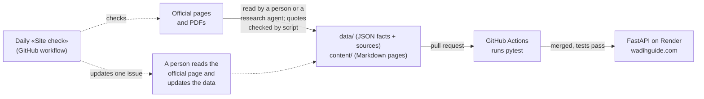

# واضح (Wadih)

Your future after high school, clearly · **مستقبلك بعد الثانوية، بوضوح**

[](https://github.com/BINMAHFOUDSALAH/scholarship-guide/actions/workflows/tests.yml)

A Saudi high school student who wants a government scholarship has to work out two things: which universities the scholarship accepts for their major, and what each of those universities asks for. Wadih is a free, Arabic-first guide that answers both with links to the official sources. A student types «أريد دراسة [تخصص] في [دولة]» ("I want to study [major] in [country]") and gets the matching universities from the Ministry's lists, each with its own admission requirements and deadline.

**Live site:** [wadihguide.com](https://wadihguide.com) (Arabic) · [wadihguide.com/en](https://wadihguide.com/en/) (English)

**Status:** live, free to browse with no account, and still in active development as the redesign is finished. وضّاح (Waddah), an AI guide, appears on the homepage only as a labeled preview («مثال»). It is not live yet and has no launch date.

![The Arabic homepage of واضح: the headline «مستقبلك بعد الثانوية، بوضوح» above the editable sentence «أريد دراسة [تخصص أو جامعة…] في [أي دولة]», the lime «اعرض الجامعات» button, the «قارن الجامعات» and «جرّب قبل أن تقرر» links, and example questions such as «الذكاء الاصطناعي في أمريكا»](docs/images/home.png)

## How a student uses it

Take the homepage example «الذكاء الاصطناعي في أمريكا» (artificial intelligence in the US):

1. **The answer.** Wadih reads the sentence and returns 34 universities from «دليل الوزارة لقوائم الجامعات 2026–2027», the Ministry of Education's 2026–2027 lists. It splits them by why they appear: 18 are on the الرواد (Arruaad) list, which covers every major, and 16 are on the إمداد (Emdad) list for the major's field.
2. **Two separate questions on every university.** «الابتعاث» (the scholarship) asks whether the university is on the track's list for this major. «القبول» (admission) asks what the university itself requires: English test scores, SAT/ACT, and its next deadline. Being on a scholarship list doesn't mean a student meets the university's admission requirements. The scholarship needs an offer from the university first, so Wadih keeps the two apart.
3. **Where each fact comes from.** Each card lists its sources («المصادر»), and the university page cites the Ministry's guide down to the page number. Each requirement links to the university's own admissions page. A fact Wadih hasn't verified says so («لم نتحقق منه»), and a university with no published minimum says that too.
4. **Saving.** «احفظ» adds the university to «خطتي» (My plan), which keeps the student's choices, progress and upcoming deadlines in order and can export them to a calendar. The plan is saved only in the current browser: there's no account, and clearing the browser's data removes it.


Around that journey:

- «حسب صفك» gives a page for each secondary year: what matters in first, second and third year.
- «البرامج» lists the programs open after high school and whether each one is open now: the government scholarship and its tracks, SDAIA, KAUST and Aramco.
- «قارن» puts up to four universities side by side.
- «الآن» on the homepage shows what's open and the nearest university deadlines.

## How official information reaches students



- **Facts live in data, with their sources.** Scholarship programs, the Ministry's university lists (290 universities in 15 countries) and the admission files researched for 184 universities are JSON in `data/`. Every fact has an official `https` source and the date it was checked, and the pages render from those records.
- **The trust rules are tests.** `pytest` fails if a fact has no official source, an Arabic text has no English translation, a colour fails its contrast check, or a page loads anything from a third party.
- **A daily check, not automatic updates.** The [`watch`](.github/workflows/watch.yml) workflow runs every morning. It reruns the tests and looks for new واعد announcements on the Ministry's page. It also checks a short list of watched official pages ([`scripts/watch_pages.json`](scripts/watch_pages.json)) for changed wording, flags passed deadlines, stale facts and broken official links, and checks every page in the live sitemap. It reports in one «Site check» issue and never edits the data. A person reads the official page and makes any change.
- **Built with AI, reviewed by a person.** [Claude Code](https://code.claude.com/docs) research agents read official pages and a script checks their quotes against the page. A person decides what ships. The rules are in [CLAUDE.md](CLAUDE.md).

**Stack:** Python 3.13, FastAPI, Jinja2, Markdown content, plain CSS and JavaScript (no frontend framework), SQLite full-text search (FTS5), GitHub Actions, Render. `/en/...` serves the same pages in English.

## Run it locally

You need Python 3.13 (the version CI tests).

```bash
python -m venv .venv
source .venv/bin/activate          # Windows PowerShell: .venv\Scripts\Activate.ps1
pip install -r requirements-dev.txt
uvicorn app.main:app --reload      # then open http://127.0.0.1:8000 (English: /en/)
```

Run the tests:

```bash
pytest
```

The browser checks in `scripts/check_*.mjs` (for example `node scripts/check_compare.mjs http://127.0.0.1:8000`) need Node and Playwright. [docs/README.md](docs/README.md) lists them with the data maintenance commands.

## Project layout

| Path | What's there |
|---|---|
| [`app/`](app/) | FastAPI app, Jinja2 templates, CSS and JavaScript |
| [`data/`](data/) | Official facts as JSON, each with its source; English in `data/i18n/` |
| [`content/`](content/) | Page text in Markdown; English in `content/en/` |
| [`tests/`](tests/) | The pytest suite, including the trust rules |
| [`scripts/`](scripts/) | Rebuilding the universities list, source and quote checks, the daily check, browser checks |
| [`docs/`](docs/) | Architecture, roadmap, specs and research notes |
| [`marketing/`](marketing/) | The launch ad's guide and build scripts (paused; separate from the app) |
| [`.github/`](.github/) | Tests, the daily check, Dependabot |
| [`CLAUDE.md`](CLAUDE.md), [`.claude/`](.claude/) | Project rules, subagents and skills for Claude Code |

## Read more

- [Architecture](docs/architecture.md): how the code fits together
- [Roadmap](docs/plan.md): what's being built next
- [Project log](docs/log.md): open questions and verification gaps
- [All documentation](docs/README.md)

## Found a mistake?

[Open an issue](https://github.com/BINMAHFOUDSALAH/scholarship-guide/issues/new) with a link to the official page that shows the right fact. Issues are public, so please leave out personal information.

## Licence

The code is under the [MIT License](LICENSE). The licence does not cover:

- the guide text and facts in `content/` and `data/`, or the name واضح, its logo and its drawings: all rights reserved;
- third-party material: fonts and flags keep their own licences (the files are next to them in `app/static/`), and official logos and photos belong to their owners ([credits](https://wadihguide.com/about#credits)).
