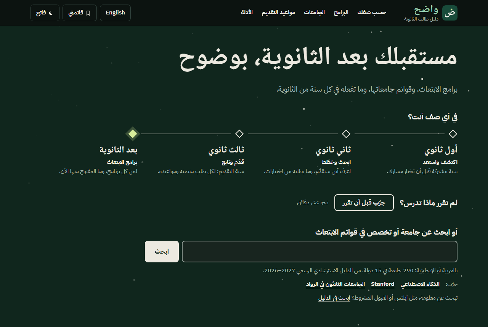
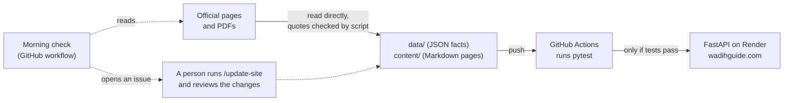

# واضح (Wadih)

Your future after high school, clearly · **مستقبلك بعد الثانوية، بوضوح**

[](https://github.com/BINMAHFOUDSALAH/scholarship-guide/actions/workflows/tests.yml)

A free, Arabic-first guide for Saudi high school students: the programs open to them after graduation (the government scholarship and its tracks, SDAIA, KAUST, Aramco), what each one requires, which universities are on the official lists, and what to do next.

**Live site:** [wadihguide.com](https://wadihguide.com) (Arabic) · [wadihguide.com/en](https://wadihguide.com/en/) (English)

**Status:** live and in active development. The full launch is planned for December 2026 ([roadmap](docs/roadmap.md)).



> **Independent.** واضح is a student guide. It is not the Ministry of Education or Safeer, and it is not affiliated with Aramco, KAUST or SDAIA.

## Principles

- **Official sources only.** A fact links to the official page it came from. Anything not backed by an official source or the owner's confirmation stays hidden, not guessed.
- **Help first.** Everything is public: no account and no sign-up.
- **Private by default.** No trackers, and no third-party requests until a student acts (fonts are self-hosted; the only embed is a click-to-play video). Never asks for sensitive data such as a national ID, GPA or test scores.

## How it works



- **Serving:** FastAPI reads facts from `data/` and page text from `content/`, and renders them with Jinja2. There is no frontend framework, and `/en/...` is the same site in English.
- **Trust rules are tests:** `pytest` fails if a fact has no official `https` source, an Arabic text has no English, a colour fails its contrast check, or a page loads anything from a third party.
- **Staying current:** every morning a workflow checks the official pages, the deadlines in the data and the live site. It opens an issue only for something new or urgent, and it never changes the site.
- **Built with AI, reviewed by a person:** [Claude Code](https://code.claude.com/docs) subagents research official pages, a script checks their quotes against the page, and a person decides what ships. The rules are in [CLAUDE.md](CLAUDE.md).

**Stack:** Python 3.13, FastAPI, Jinja2, plain CSS and JavaScript, SQLite full-text search, GitHub Actions, Render.

## Run it locally

You need Python 3.13.

```bash
python -m venv .venv
source .venv/bin/activate          # Windows PowerShell: .venv\Scripts\Activate.ps1
pip install -r requirements-dev.txt
uvicorn app.main:app --reload      # then open http://127.0.0.1:8000
```

Run the tests:

```bash
pytest
```

## Project layout

| Path | What's there |
|---|---|
| [`app/`](app/) | FastAPI app, Jinja2 templates, CSS and JavaScript |
| [`data/`](data/) | Official facts as JSON, each with its source; English in `data/i18n/` |
| [`content/`](content/) | Page text in Markdown; English in `content/en/` |
| [`tests/`](tests/) | The pytest suite, including the trust rules |
| [`scripts/`](scripts/) | Rebuilding the universities list, source and quote checks, the morning check |
| [`docs/`](docs/) | Architecture, decisions, roadmap, specs and research notes |
| [`marketing/`](marketing/) | The launch ad's guide and build scripts (paused; separate from the app) |
| [`.github/`](.github/) | Tests, the morning check, Dependabot |
| [`CLAUDE.md`](CLAUDE.md), [`.claude/`](.claude/) | Project rules, subagents and skills for Claude Code |

## Read more

- [Architecture](docs/architecture.md): how the code fits together
- [Decisions](docs/decisions.md): every design choice, with the alternatives and why
- [Roadmap](docs/roadmap.md): where the project is and what's next
- [All documentation](docs/README.md)

## Found a mistake?

[Open an issue](https://github.com/BINMAHFOUDSALAH/scholarship-guide/issues/new) with a link to the official page that shows the right fact. Issues are public, so please leave out personal information.

## Licence

The code is under the [MIT License](LICENSE). The licence does not cover:

- the guide text and facts in `content/` and `data/`, or the name واضح, its logo and its drawings: all rights reserved;
- third-party material: fonts and flags keep their own licences (the files are next to them in `app/static/`), and official logos and photos belong to their owners ([credits](https://wadihguide.com/about#credits)).
